# IPv2 – Benutzeranleitung

IPv2 ist eine vereinfachte Netzwerksimulation für den Informatikunterricht.
Jeder Browser-Tab wird zu einem **Gerät** – einem PC, einem DHCP-, DNS- oder Webserver
oder einem Router. Die Geräte schicken sich echte (simulierte) Pakete und
schreiben jeden Schritt in ein **Protokoll**. So lässt sich beobachten, wie DHCP, ARP,
IP, UDP, TCP, DNS und HTTP zusammenarbeiten, wenn jemand eine Webseite aufruft.

## Inhalt

1. [Die wichtigsten Begriffe](#1-die-wichtigsten-begriffe)
2. [Los geht's: Netzwerknamen wählen](#2-los-gehts-netzwerknamen-wählen)
3. [Der Client: eine Webseite abrufen](#3-der-client-eine-webseite-abrufen)
4. [Das Protokoll lesen](#4-das-protokoll-lesen)
5. [DHCP-Server](#5-dhcp-server)
6. [DNS-Server](#6-dns-server)
7. [Webserver](#7-webserver)
8. [Zwei Netze mit einem Router verbinden](#8-zwei-netze-mit-einem-router-verbinden)
9. [Fehlersuche](#9-fehlersuche)
10. [Ideen für den Unterricht](#10-ideen-für-den-unterricht)
11. [Was ist anders als im echten Netz?](#11-was-ist-anders-als-im-echten-netz)
12. [Für Lehrkräfte: Installation und Betrieb](#12-für-lehrkräfte-installation-und-betrieb)

## 1. Die wichtigsten Begriffe

| Begriff | In IPv2 | Beispiel |
|---|---|---|
| **Netzwerkname (SSID)** | Alle Geräte mit demselben Namen sind verbunden. Jede Gruppe wählt einen eigenen Namen. | `KLASSE-7B` |
| **Netzsegment (Kabel)** | Geräte im selben Segment hängen am selben „Kabel“ und erreichen sich direkt. | `10` |
| **MAC-Adresse** | Feste Adresse der Netzwerkkarte, drei Hex-Bytes. Wird automatisch erzeugt. | `3F:A0:7C` |
| **IP-Adresse** | Zwei Zahlen: **Netz.Host**. Die erste Zahl ist das Netz, die zweite das Gerät. | `10.5` |
| **Broadcast** | Nachricht an alle: `255.255` (IP) bzw. `FF:FF:FF` (MAC). | |
| **Standard-Gateway** | Router, an den Pakete für **andere Netze** geschickt werden. | `10.1` |
| **DNS-Server** | Gerät, das Namen in IP-Adressen übersetzt. | `10.3` |

Zwei Geräte sind im selben Netz, wenn die erste Zahl ihrer IP-Adressen gleich ist
(`10.5` und `10.100` ja, `10.5` und `20.4` nein).

## 2. Los geht's: Netzwerknamen wählen

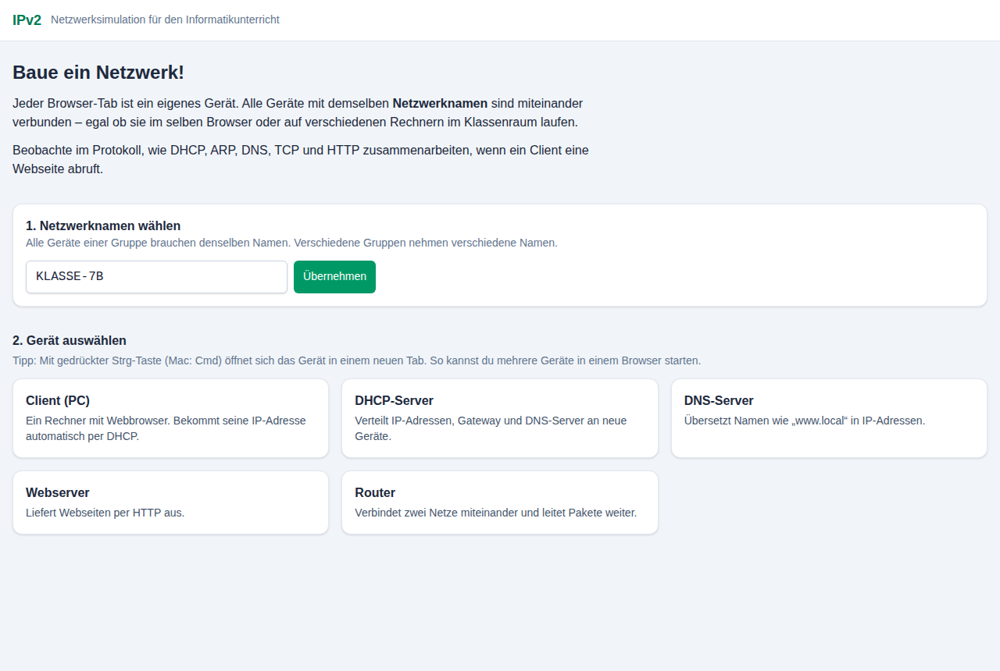

1. Öffne die Startseite.
2. Trage unter **1. Netzwerknamen wählen** den Namen eurer Gruppe ein und klicke auf **Übernehmen**.
   Alle Geräte eurer Gruppe müssen denselben Namen benutzen – auch auf anderen Rechnern.
3. Wähle unter **2. Gerät auswählen**, was dieser Tab sein soll.

> **Tipp:** Mit gedrückter <kbd>Strg</kbd>-Taste (Mac: <kbd>Cmd</kbd>) öffnet sich das Gerät in einem
> neuen Tab. So kann eine Person mehrere Geräte gleichzeitig betreiben.

Die Voreinstellungen passen zusammen:

| Gerät | IP-Adresse | Besonderheit |
|---|---|---|
| Router | `10.1` und `20.1` | zwei Netzwerkkarten |
| DHCP-Server | `10.2` | vergibt `10.100` bis `10.199` |
| DNS-Server | `10.3` | kennt `dns.local` und `www.local` |
| Webserver | `10.4` | liefert eine Startseite aus |
| Client (PC) | – | holt sich seine Adresse per DHCP |

Ein Gerät behält seine Einstellungen, solange der Tab offen ist (auch beim Neuladen).
Wird ein Gerät über die Startseite neu gewählt, startet es mit den Voreinstellungen.

## 3. Der Client: eine Webseite abrufen

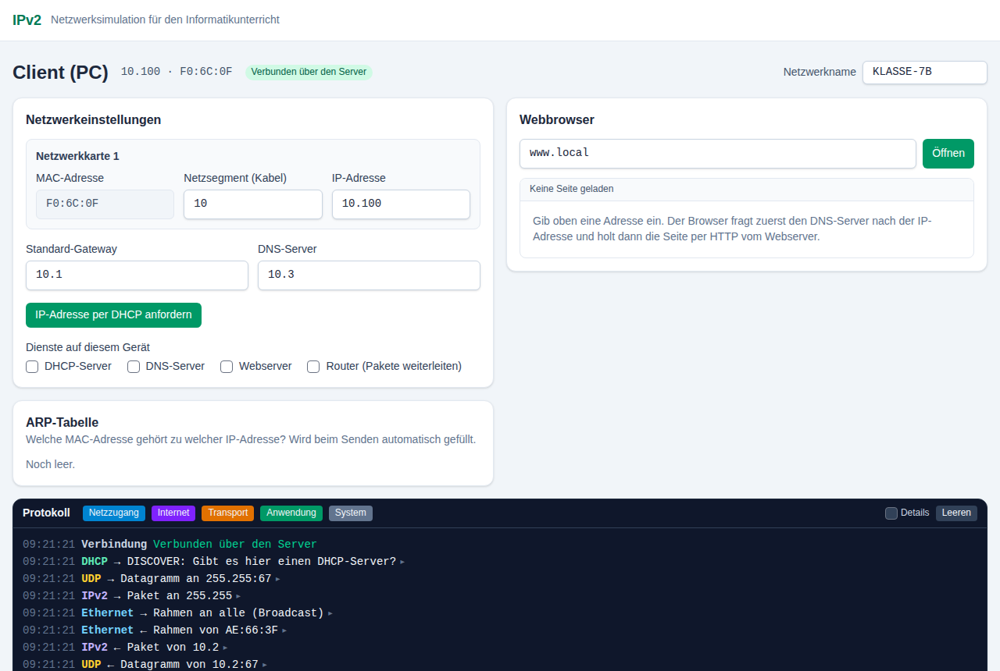

Ein neuer Client hat zunächst **keine IP-Adresse**. Er fragt deshalb sofort per DHCP nach einer.
Ist ein DHCP-Server im Netz, stehen danach IP-Adresse, Standard-Gateway und DNS-Server in den
**Netzwerkeinstellungen**. Oben neben dem Gerätenamen siehst du jederzeit IP- und MAC-Adresse.

- **Leeres IP-Feld** bedeutet: Adresse per DHCP holen. Mit **IP-Adresse per DHCP anfordern**
  lässt sich das jederzeit wiederholen.
- Du kannst die Adresse auch **von Hand** eintragen. Ungültige Eingaben werden rot markiert.
- Unter **Dienste auf diesem Gerät** kann jedes Gerät zusätzlich zum Server oder Router werden.

Gib im **Webbrowser** eine Adresse ein (z. B. `www.local`) und klicke auf **Öffnen**:

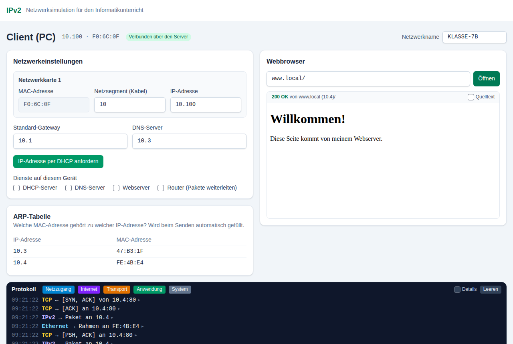

Dabei passiert Folgendes (alles im Protokoll zu sehen):

1. **DNS:** Der Client fragt den DNS-Server: „Welche IP-Adresse hat `www.local`?“ – Antwort: `10.4`.
2. **ARP:** Um `10.4` im eigenen Netz zu erreichen, braucht der Client dessen MAC-Adresse.
   Er fragt per Broadcast „Wer hat `10.4`?“ – der Webserver antwortet.
3. **TCP:** Der Client baut eine Verbindung zum Port 80 auf (Drei-Wege-Handshake).
4. **HTTP:** Der Client schickt `GET /`, der Server antwortet mit `200 OK` und der Seite.
5. **TCP:** Die Verbindung wird wieder abgebaut.

Die **ARP-Tabelle** zeigt, welche MAC-Adressen sich das Gerät gemerkt hat.

Erlaubte Adressen im Browser: `www.local`, `www.local/kontakt`, `10.4`, `10.4/kontakt`,
`http://www.local:80/`. Links in den geladenen Seiten funktionieren ebenfalls.

## 4. Das Protokoll lesen

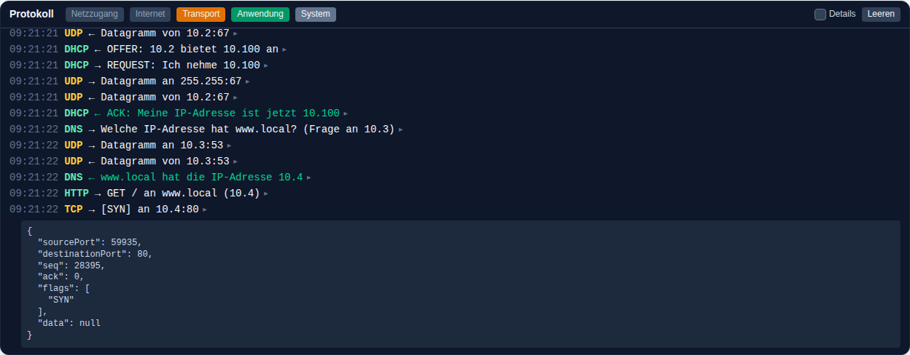

Jede Zeile ist ein Schritt auf einer Schicht des TCP/IP-Modells:

| Farbe | Schicht | Protokolle |
|---|---|---|
| grün | Anwendung | DHCP, DNS, HTTP |
| orange | Transport | UDP, TCP |
| lila | Internet | IPv2 |
| blau | Netzzugang | Ethernet, ARP, Kabel |
| grau | System | Verbindung zum Server |

- **→** bedeutet „gesendet“, **←** bedeutet „empfangen“.
- Beim Senden wandert eine Nachricht **von oben nach unten** durch die Schichten
  (DNS → UDP → IPv2 → Ethernet), beim Empfangen **von unten nach oben**.
- Zeilen mit **▸** lassen sich anklicken. Dann wird das komplette Paket angezeigt,
  z. B. Ports, Sequenznummern und Flags eines TCP-Segments.
- Mit den farbigen Schaltflächen oben werden Schichten aus- und eingeblendet.
  Im Bild sind Netzzugang und Internet ausgeblendet, damit man DHCP, DNS, TCP und HTTP besser sieht.
- **Details** zeigt zusätzlich Hintergrundinformationen, z. B. verworfene Pakete,
  die nicht für dieses Gerät bestimmt waren, und die Zustände der TCP-Verbindung.
- **Leeren** löscht das Protokoll.

## 5. DHCP-Server

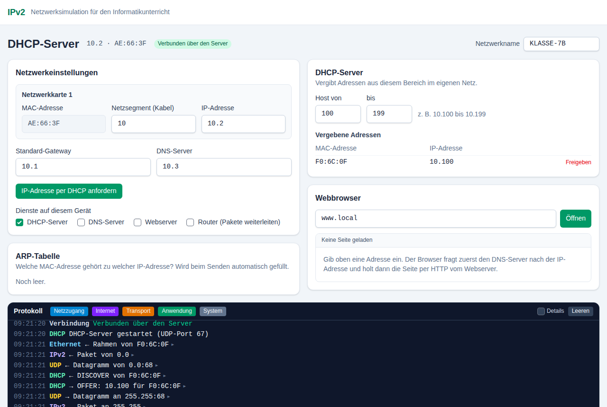

Der DHCP-Server vergibt Adressen aus dem eingestellten Bereich (**Host von … bis …**) im Netz
seiner eigenen IP-Adresse. Zusätzlich teilt er den Clients **sein** Standard-Gateway und
**seinen** DNS-Server mit – diese Felder müssen beim DHCP-Server also richtig ausgefüllt sein.

Unter **Vergebene Adressen** steht, welche MAC-Adresse welche IP bekommen hat.
Fragt dasselbe Gerät erneut, bekommt es wieder dieselbe Adresse.
**Freigeben** gibt eine Adresse wieder zur Vergabe frei.

Der Ablauf im Protokoll: `DISCOVER` → `OFFER` → `REQUEST` → `ACK` (alles per Broadcast,
weil der Client noch keine Adresse hat).

## 6. DNS-Server

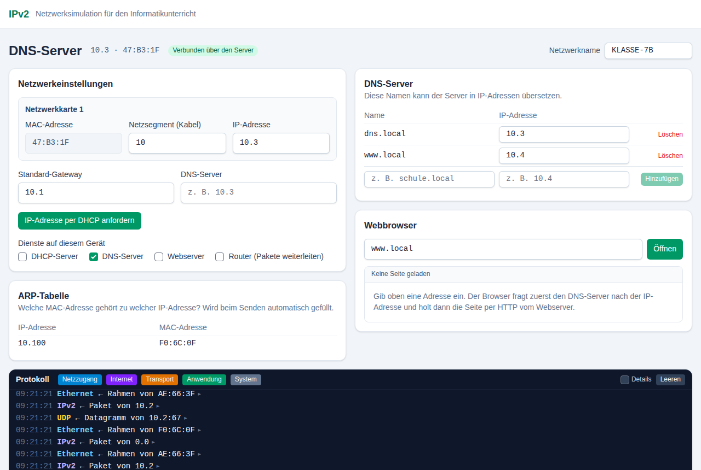

Der DNS-Server übersetzt Namen in IP-Adressen. In der Tabelle können Einträge hinzugefügt,
geändert und gelöscht werden. Groß- und Kleinschreibung spielt keine Rolle.

Kennt der DNS-Server einen Namen nicht und hat er selbst einen DNS-Server eingetragen,
fragt er dort weiter (**rekursive Auflösung**). So lassen sich Ketten von DNS-Servern bauen.

## 7. Webserver

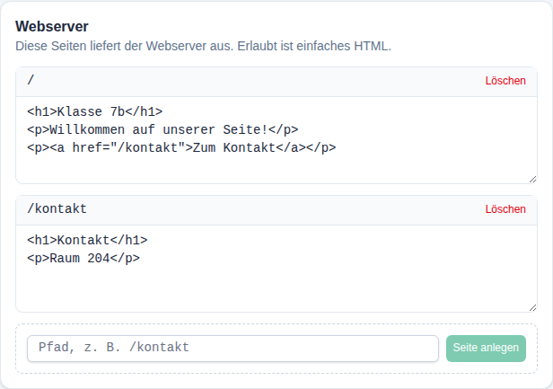

Der Webserver liefert die Seiten aus der Liste aus. Jede Seite hat einen **Pfad**
(`/` ist die Startseite) und einen Inhalt in einfachem HTML. Neue Seiten werden unten angelegt.
Änderungen gelten, sobald man das Textfeld verlässt.

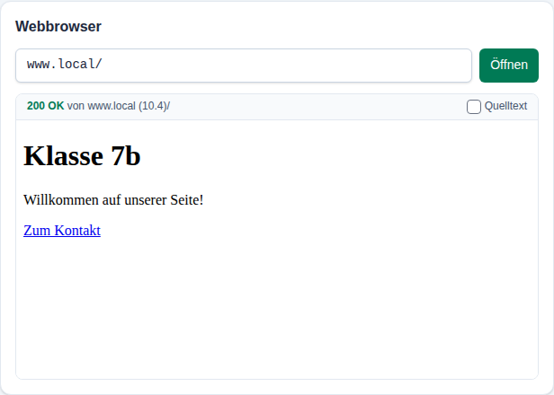

Gibt es einen Pfad nicht, antwortet der Server mit **404 Not Found**:

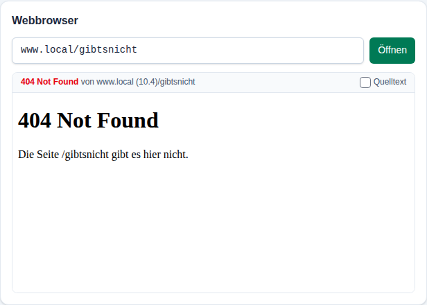

> JavaScript wird in den Seiten aus Sicherheitsgründen nicht ausgeführt.
> Mit **Quelltext** zeigt der Browser das HTML statt der fertigen Seite.

## 8. Zwei Netze mit einem Router verbinden

Ein Router hat mehrere Netzwerkkarten – eine in jedem Netz. Pakete für ein fremdes Netz schickt
ein Gerät an sein **Standard-Gateway**, der Router leitet sie in das richtige Netz weiter.

Beispiel: Der Webserver steht in Netz 20, alle anderen Geräte in Netz 10.

1. **Router** öffnen. Er hat schon zwei Netzwerkkarten: `10.1` (Segment 10) und `20.1` (Segment 20).
2. **DHCP-Server** und **DNS-Server** öffnen (beide in Netz 10). Beim DNS-Server
   die Adresse von `www.local` auf `20.4` ändern.
3. **Webserver** öffnen und umstellen: Netzsegment `20`, IP-Adresse `20.4`, Standard-Gateway `20.1`.

   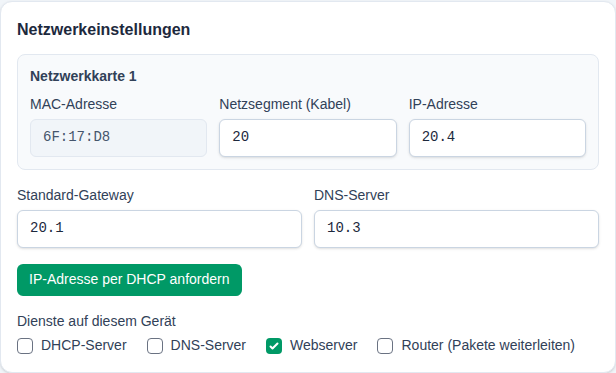

4. **Client** öffnen und `www.local` aufrufen.

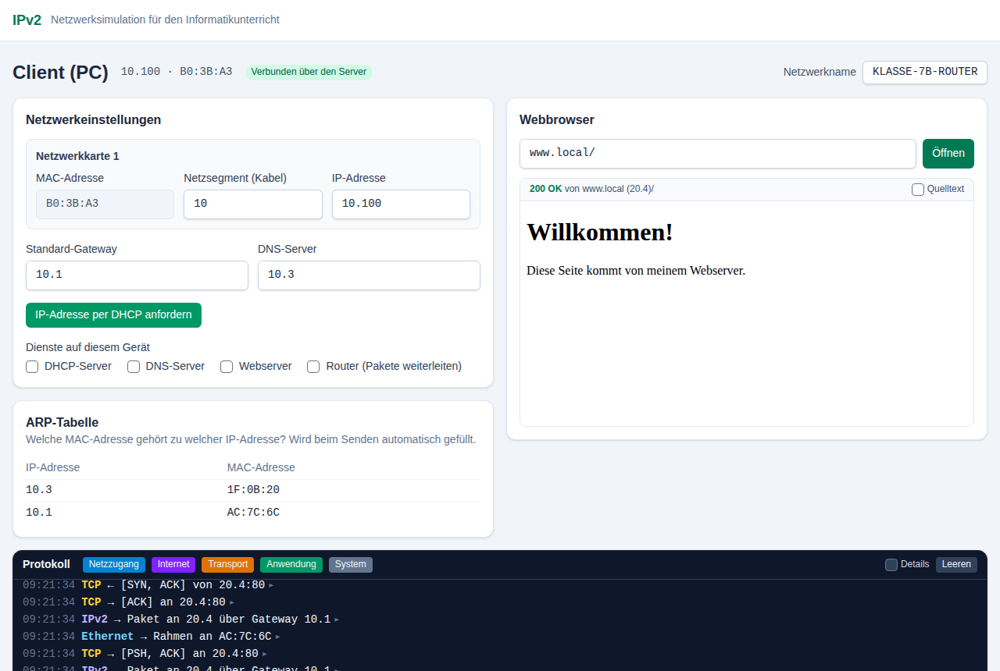

Im Protokoll des Clients steht jetzt „Paket an 20.4 **über Gateway 10.1**“: Der Client schickt das
Paket an die MAC-Adresse des Routers, nicht an die des Webservers. Im Protokoll des Routers
erscheint „Weiterleiten: 10.100 → 20.4 über Netzwerkkarte 2“ – und für die Antwort
„Weiterleiten: 20.4 → 10.100 über Netzwerkkarte 1“. Die ARP-Tabelle des Routers enthält
Einträge aus beiden Netzen:

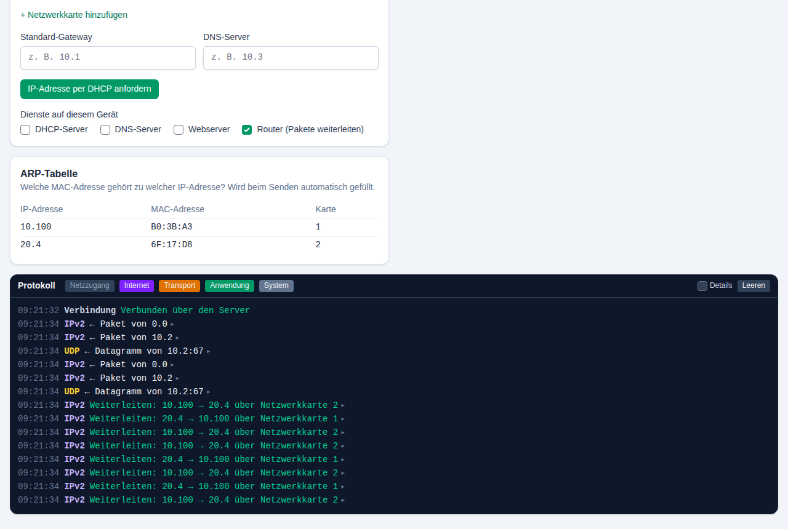

Gut zu wissen:

- Mit **+ Netzwerkkarte hinzufügen** bekommt ein Router weitere Netze.
- Jedes Gerät mit Häkchen bei **Router (Pakete weiterleiten)** leitet Pakete weiter.
- Pakete haben eine **TTL** (Lebensdauer). Jeder Router zieht 1 ab; bei 0 wird das Paket verworfen.
  So enden Routing-Schleifen, z. B. wenn zwei Router sich gegenseitig als Gateway eintragen.
- Auch ein Router kann DHCP-Server sein. Er vergibt dann in jedem Netz Adressen aus dem passenden Netz.

## 9. Fehlersuche

| Meldung | Ursache und Lösung |
|---|---|
| **Kein DHCP-Server hat geantwortet** | Kein DHCP-Server mit demselben Netzwerknamen im selben Segment. Netzwerknamen und Netzsegment prüfen. |
| **Keine freie IP-Adresse mehr im Adressbereich** | Der Bereich des DHCP-Servers ist voll. Bereich vergrößern oder alte Adressen freigeben. |
| **Kein DNS-Server eingetragen** | Beim Client fehlt der DNS-Server. Von Hand eintragen oder beim DHCP-Server ergänzen und erneut per DHCP anfordern. |
| **DNS: Der Name „…“ ist unbekannt** | Der Name fehlt in der Tabelle des DNS-Servers (Tippfehler?). |
| **Keine Antwort: Niemand im Netz hat die IP-Adresse …** | ARP findet das Ziel nicht: falsche IP, Gerät nicht gestartet, anderes Segment oder anderer Netzwerkname. |
| **Kein Weg zu …: anderes Netz und kein passendes Standard-Gateway** | Das Ziel liegt in einem anderen Netz, aber es ist kein (erreichbares) Gateway eingetragen. |
| **Verbindung … abgelehnt (Port geschlossen)** | Auf dem Zielgerät läuft kein Webserver (Häkchen bei „Webserver“ fehlt). |
| **TCP: Zeitüberschreitung …** | Pakete kommen nicht an, z. B. weil beim Router „Pakete weiterleiten“ fehlt oder der Rückweg (Gateway des Servers) nicht stimmt. |
| **IP-Adresskonflikt** | Zwei Geräte haben dieselbe IP-Adresse. Eine davon ändern. |
| **MAC-Adresse … ist doppelt vergeben** | Meist wurde ein Tab dupliziert. Das Gerät erzeugt automatisch eine neue MAC-Adresse. |
| Gelber Hinweis **Ohne Server: nur Tabs in diesem Browser** | Der Server ist nicht erreichbar. Geräte auf anderen Rechnern sind dann nicht verbunden. |

## 10. Ideen für den Unterricht

- **DHCP beobachten:** Einen Client starten, bevor es einen DHCP-Server gibt. Was passiert?
  Dann den DHCP-Server starten und „IP-Adresse per DHCP anfordern“ klicken.
- **Wer antwortet auf ARP?** Im Protokoll eines unbeteiligten Geräts (mit **Details**) nachsehen,
  welche Rahmen es empfängt und welche es verwirft.
- **Drei-Wege-Handshake:** Nur die Transportschicht einblenden und die Segmente des Clients
  aufklappen. Wie hängen `seq` und `ack` zusammen?
- **DNS-Fehler:** Beim DNS-Server `www.local` löschen oder auf eine falsche IP setzen.
- **Port geschlossen:** Beim Webserver das Häkchen „Webserver“ entfernen und die Seite erneut laden.
- **Routing:** Das Beispiel aus Abschnitt 8 nachbauen und anschließend absichtlich das Gateway
  des Webservers löschen. Warum kommt die Anfrage an, aber keine Antwort zurück?
- **Eigenes Internet:** Jede Gruppe baut ein Netz mit Webserver; ein Router verbindet die Netze.

## 11. Was ist anders als im echten Netz?

IPv2 vereinfacht bewusst, damit die Abläufe überschaubar bleiben:

- IP-Adressen haben nur **zwei** Zahlen (`Netz.Host`) statt vier; die „Subnetzmaske“ ist fest:
  Die erste Zahl ist immer das Netz.
- MAC-Adressen haben drei statt sechs Bytes.
- Pakete gehen nie verloren und kommen in der richtigen Reihenfolge an.
- TCP schickt genau **eine Anfrage und eine Antwort** pro Verbindung. Sequenz- und
  Bestätigungsnummern zählen die Länge der Daten in Zeichen.
- DHCP-Adressen laufen nie ab, DNS kennt nur Einträge vom Typ A, HTTP nur `GET`.
- Pakete sind lesbare JSON-Objekte statt Bits und Bytes.

## 12. Für Lehrkräfte: Installation und Betrieb

Damit sich Geräte auf **verschiedenen Rechnern** verbinden, braucht es einen kleinen Server.
Er verteilt die Pakete zwischen den Browsern (wie ein Hub). Benötigt wird [Node.js](https://nodejs.org/) ab Version 20.19.

```bash
npm install
npm run build
node .output/server/index.mjs        # startet auf Port 3000
```

Die Schülerinnen und Schüler öffnen dann `http://<IP-des-Lehrer-PCs>:3000`.
Mit `PORT=8080 node .output/server/index.mjs` lässt sich der Port ändern.

**Ohne Server:** Wird die App nur als statische Seite veröffentlicht (`npm run generate`,
Ordner `.output/public`), sind nur die Tabs **im selben Browser** miteinander verbunden.
Die Geräte zeigen dann den gelben Hinweis „Ohne Server: nur Tabs in diesem Browser“.
Über die Umgebungsvariable `NUXT_PUBLIC_WS_URL` (z. B. `wss://example.org/_ws`) kann eine
statische Seite auch einen anderswo laufenden IPv2-Server verwenden.

Hinweise:

- Der Server speichert nichts. Alle Einstellungen liegen im Browser
  (Netzwerkname im `localStorage`, Geräteeinstellungen im `sessionStorage` des Tabs).
- Ein Tab ist ein Gerät. Wird ein Tab geschlossen, ist das Gerät weg.
- Gruppen mit unterschiedlichen Netzwerknamen stören sich nicht.
